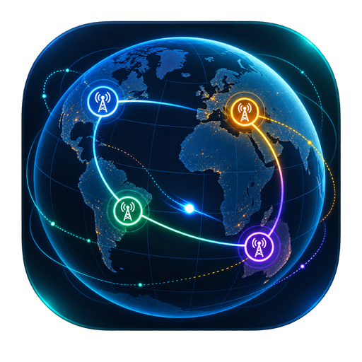
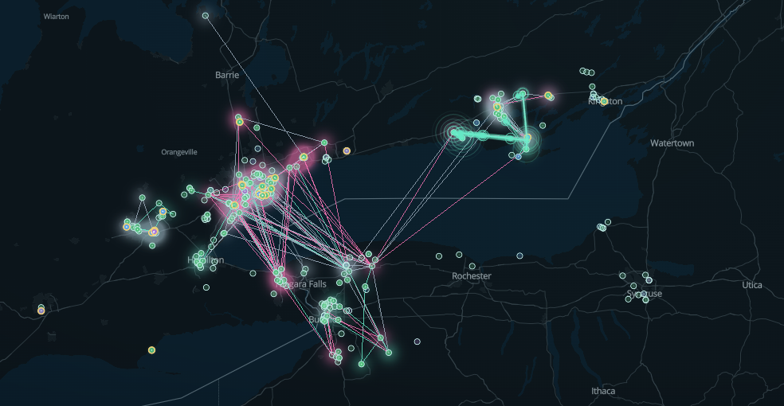
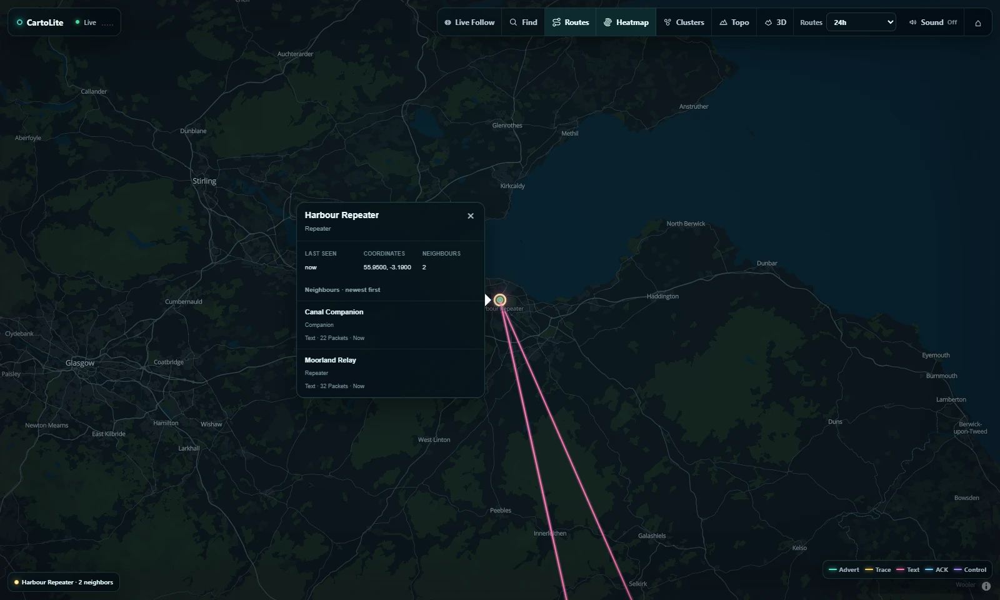
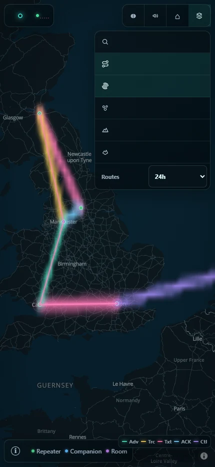

<p align="center">
  
</p>

<h1 align="center">CartoLite Server</h1>

<p align="center">
  <strong>A calm, musical live map for your MeshCore network.</strong><br>
  Turn a standard MQTT feed into a fast, privacy-safe topology experience you can host yourself.
</p>

<p align="center">
  <a href="https://github.com/n30nex/CartoLite-Server/releases/latest"></a>
  <a href="LICENSE"></a>
  <a href="https://github.com/n30nex/CartoLite-Server"></a>
</p>

<p align="center">
  <a href="#live-examples">Live examples</a> ·
  <a href="#quick-start"><strong>Start self-hosting</strong></a> ·
  <a href="docs/deployment.md">Deployment guide</a> ·
  <a href="docs/privacy.md">Privacy boundary</a> ·
  <a href="https://github.com/n30nex/CartoLite-Server/releases/latest">Latest release</a>
</p>



<p align="center"><sub>Live topology across the Great Lakes, with routes coloured by packet type.</sub></p>

## Live examples

Explore MeshCore networks using CartoLite:

- [CartoLite Canada](https://carto.canadaverse.org/)
- [EastMesh](https://carto.eastmesh.au/)
- [Flatus Lifir](https://move.flatuslifir.is/)

## See your mesh move

CartoLite Server renders public MeshCore activity as a living map: packet trails travel hop by hop, recently heard routes hold a restrained glow, and packet types keep distinct colours. Optional Web Audio turns every visible live hop into a musical articulation. Stronger Topo shading and terrain-aware trails, ground rings, and route history add context in 3D; enabling 3D also enables Topo. The worldwide [Netgraph](docs/netgraph.md) adds a stable topology view grouped by Maidenhead grid squares, with touch navigation, synchronized traffic, and node inspection.

<table>
  <tr>
    <td width="68%">
      
    </td>
    <td width="32%">
      
    </td>
  </tr>
  <tr>
    <td align="center"><sub>Inspect a node, its newest neighbours, and connected routes.</sub></td>
    <td align="center"><sub>Touch-friendly controls keep the map primary on phones.</sub></td>
  </tr>
</table>

## Built for community operators

| | |
|---|---|
| **Live topology** | Vector geography, six route styles, packet-type heat, clusters, terrain and desktop 3D buildings. |
| **Make it yours** | Shared Map/Netgraph/Chronoscope themes, preset and advanced line controls, readable light/dark palettes, and saved display choices. |
| **Find and inspect** | Search downloaded node labels, open node details, and browse neighbours sorted by last heard. |
| **Musical traffic** | A grouped choice of [31 sound voices](docs/sound-voices.md), using opt-in native browser audio and visible live hops only. |
| **Works worldwide** | Accept valid coordinates anywhere, or apply an exact region allowlist for a shared broker. |
| **Responsive and resilient** | Desktop and phone layouts, Live Follow, saved views, and automatic recovery after sleep or network loss. |
| **Small operational footprint** | One dependency-light Go service, one atomic checkpoint, no database, and a hardened container. |

## Choose your pages

Map and Netgraph are enabled by default. To offer the extra views, set this in `.env` and apply the matching release's Compose file:

```dotenv
EXTRA_PAGES=terminal,chronoscope,firehose
```

Choose any subset, or leave it empty for Map and Netgraph only. Navigation on desktop and phones follows the operator's selection. **Upgrading an existing server?** Set this before upgrading to keep all five pages; extra pages now default to off. Labs remains Canada-only. [Configuration and upgrade details](docs/deployment.md#choose-the-pages-on-your-server).

## Privacy is the product boundary

The public API exposes only the minimum sanitized data needed to draw the live topology. CartoLite Server does **not** publish public keys, observer keys, raw paths, packet bodies, decoded messages, or resolver details. It includes no visitor analytics, accounts, chat, or message history.

See the exact guarantees in the [privacy documentation](docs/privacy.md) and the stable [public API v2 contract](docs/public-api.md).

## Quick start

You need Docker Engine, Docker Compose v2, and a standard MeshCore MQTT feed. The published image supports Intel/AMD servers and ARM64 hosts. OpenFreeMap works without an account or map key.

> [!IMPORTANT]
> No API keys, passwords, or tokens are bundled with this repository. `.env` and `.secrets/` are excluded from Git and the Docker build context.

Download the two installation files into a new folder:

```sh
curl -fLO https://github.com/n30nex/CartoLite-Server/releases/latest/download/compose.yml
curl -fL https://github.com/n30nex/CartoLite-Server/releases/latest/download/default.env.example -o .env
```

Set `MQTT_BROKER_URL`, `MQTT_TOPIC`, and any required MQTT username/password in `.env`, then start:

```sh
docker compose pull
docker compose up -d --no-build
curl --fail http://127.0.0.1:8080/readyz
```

Open [the map](http://localhost:8080/) or [Netgraph](http://localhost:8080/netgraph/). In Windows PowerShell, use `curl.exe` for the download commands. Existing installations should follow the [upgrade guide](docs/deployment.md#upgrades) and retain their current `.env` and data volume.

The default bind is loopback-only. Keep it behind a TLS reverse proxy for public operation, or deliberately set `CARTOLITE_BIND_ADDR=0.0.0.0` for trusted LAN access.

## MQTT input

MQTT bridge envelopes are limited to 64 KiB before normalization, and RF evidence must contain finite numbers. The geographic map requires WebGL2; Netgraph uses Canvas2D.

The subscriber defaults to `meshcore/#` and accepts the standard topic shape:

```text
meshcore/<region>/<publisher-key>/packets
meshcore/<region>/<publisher-key>/status
```

`REGION_ALLOWLIST` is empty by default, so every syntactically valid region is accepted. Set it to exact comma-separated labels such as `EU_WEST,AU_NSW` when a shared broker should feed separate public maps. Use `MQTT_TOPIC` to narrow the subscription itself.

The server accepts the standard packet/status JSON or raw packet hex published by a MeshCore MQTT bridge. Unknown topic shapes and malformed messages are counted and ignored.

## Map providers

OpenFreeMap supplies the default vector map and buildings. Terrain comes from Mapterhorn. Both are attributed in the map.

CARTO remains optional through `compose.carto.yml` and a mounted browser-key file. Configuration is read at startup, so the same published image works for every operator. Browser keys are visible to visitors by design; MQTT credentials remain server-only. See the [provider configuration](docs/deployment.md#optional-carto-provider).

## Project scope

This repository contains the standalone server, browser map, and worldwide Netgraph. It has no country boundary, default region allowlist, Android app, Labs, analytics, database, chat, history, or operator dashboard.

## Documentation

- [Audit roadmap and current work](docs/roadmap.md)
- [Deployment](docs/deployment.md)
- [Architecture](docs/architecture.md)
- [Privacy boundary](docs/privacy.md)
- [Public API v2](docs/public-api.md)
- [Data sources](docs/data-sources.md)
- [Sound and animation](docs/sound-and-animation.md)
- [Worldwide Netgraph](docs/netgraph.md)
- [Upstream refresh and validation](docs/upstream-refresh-0.2.0.md)
- [Security policy](SECURITY.md)

## License

[MIT](LICENSE). CartoLite Server is derived from the CartoLite map system and keeps its privacy-first public-data boundary.

## Cinematic display

Map and Netgraph share effects intensity, six route presets, detail level,
graphics quality, motion and text size. New settings default to Spectacle with
automatic detail/quality and the system motion preference. Existing appearance,
layer and audio choices are preserved. Sound stays opt-in; Preview voice plays
one explicit sample without enabling live audio.

The dock holds navigation, Find, Layers, Follow, Sound and Display. Network,
Activity and Landscape combinations change layers only and include Undo.
Follow holds each live subject for ten seconds and supports fixed-area or
selected-node scopes, Hold, Next and Inspect. It never replays old traffic.
Netgraph adds area/component focus without rearranging the network.

GPU packet effects use the same geographic projections and hop clock as the
Canvas fallback. Automatic detail reduces background decoration, not retained
connections. Terrain and buildings are visual context, not RF coverage or
measured antenna heights. A missing basemap does not prevent using Netgraph.


## Optional 3D Netgraph

Netgraph opens top-down. Tap **3D** to tilt the same geographic groups into
raised nodes, regional platforms and arched connections. Drag to pan;
Shift-drag or right-drag rotates on desktop, while two-finger pinch/twist zooms
and rotates on phones. Display also has rotation, tilt and Top-down controls.

Selecting a node frames its recent confirmed neighbours once. Tap a connection
for its endpoints, latest category, last-heard time and approximate geographic
distance, or open either endpoint on Map. The height is schematic, not measured
antenna elevation. All six route presets, themes and 31 voices still apply.

### Arrange and filter regions

In Netgraph, open **Display → Region layout** to spread region centres from 100% to
400%. Drag a region label to move its whole bubble, or choose a region and use
the arrow buttons. **Reset region layout** restores the geographic arrangement.
Nodes keep their positions inside each bubble; routes and live packets follow
when the bubble moves. These controls change the diagram, not reported locations.

Use **Regions** to search geographic region codes or names and select multiple regions.
**None** followed by one checkbox isolates a region; **All** restores the full mesh.
Only connections with both endpoints in the selected regions are shown. Search
and Follow respect this selection. Use **Routes** to hide standing connections;
live packets still illuminate their paths and leave a brief fading trace.
Layout, region choices and route visibility are remembered in this browser.

### Terminal view

When enabled with `EXTRA_PAGES`, open /terminal/ or choose **Terminal** beside Map and Netgraph (in the View picker on phones). This BBS-style geographic view uses live Braille/ASCII graphics with ANSI, amber or green phosphor. Find, inspection, layer toggles, route windows, Follow, optional 3D and opt-in sounds use the same live data and controls as Map. Set characters and cell size under **Display → Terminal display**. The character renderer is downloaded only when you open Terminal; no extra map key or service is required.

See [implementation and validation plan](docs/terminal-view-plan-2026-10-17.md).

### Terminal appearance

Open **Terminal → Display → Terminal options** for six retro presets, per-element
colours, HSL sliders, console/pixel fonts and independent map brightness/live glow.
Choose Braille, ASCII, pixel-block or cel-shaded geography; confirmed routes stay
sharp above it. Live packets can use characters or smooth strokes. Settings are
local, migrate older Terminal choices and synchronize across tabs without changing
Map/Netgraph preferences or sound. The colour editor always keeps a readable reset.
Fonts and licences are bundled in `web/public/fonts/terminal/`.

Terminal defaults match the owner-selected screenshots: routes, live packets,
heatmap, node/place labels, roads and buildings on; clusters, regions, Topo and
3D off; 15-minute routes and 15% Topo shading. Fine ANSI/BBS Braille, Spectacle,
Complete detail, High graphics, system motion, standard text and Neon routes.
Layer/display settings are independent from Map/Netgraph, and saved Terminal
customizations remain. Reset all display settings restores these Terminal defaults.

## Chronoscope

When enabled with `EXTRA_PAGES`, open /chronoscope/ or choose **Chronoscope** in the dock. A bright Now plane and fading traces show the last minute of activity observed by this page. Explore Sculpture, Slice or Flat, freeze time, select regions and inspect confirmed packet segments. Display and live sound use the existing shared controls; phone Display settings live in the View picker. The bounded session window starts empty, stays silent while frozen and never reconstructs traffic from route totals. [View guide](docs/chronoscope.md).

## Firehose

When enabled with `EXTRA_PAGES`, open `/firehose/` for a fully 3D live packet box. Tilt the box, orbit the camera, or pour linked packet beads into the pit. The pile starts empty, preserves confirmed hops and uses GPU rendering with worker physics and bounded resources. [View and controls guide](docs/firehose.md).
